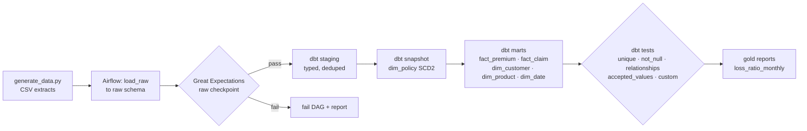

# airflow-dbt-insurance-warehouse

 

Airflow orchestrates dbt models that build a Kimball star schema for a fictional property and casualty insurer. Data-quality gates use dbt tests and Great Expectations. It runs on DuckDB locally; Snowflake and Redshift profiles are included.

> Fictional company: **Lone Star Mutual**. Policies, premium transactions, claims and customers are generated by `scripts/generate_data.py`.

## The problem
Finance and actuarial teams need written premium, earned premium and loss ratio by product, state and month. Policy attributes change mid-term. The source extracts contain duplicates and late corrections.

## Architecture


## Run it in three commands
```bash
make up      # Airflow (standalone) + DuckDB in docker compose
make demo    # generates data, triggers the DAG, prints loss_ratio_monthly
make test    # dbt build (models + tests) and pytest for DAG integrity
```

## Model
| Table | Grain | Notes |
|---|---|---|
| fact_premium | one row per premium transaction | written vs earned premium |
| fact_claim | one row per claim payment | joins to the policy version in force on the loss date |
| dim_policy | one row per policy version | SCD2 via dbt snapshot (`valid_from`, `valid_to`, `is_current`) |
| dim_customer, dim_product, dim_date | conformed dimensions | surrogate keys |

## What is inside
```
dags/insurance_warehouse.py   # TaskGroups: load → validate → dbt build → report; retries and SLAs
dbt/ models/{staging,marts,reports} snapshots/ tests/ macros/ profiles.yml (duckdb, snowflake, redshift)
great_expectations/           # raw-layer expectation suites + checkpoint
scripts/generate_data.py      # synthetic data with deliberate duplicates and late corrections
tests/test_dag_integrity.py
```

## What it proves
- Airflow + dbt orchestration with quality gates that actually stop bad data
- Dimensional modeling: facts, conformed dimensions, SCD2, point-in-time joins
- Warehouse portability: the same models run on DuckDB, Snowflake and Redshift

## Limitations
- The Snowflake and Redshift profiles are templates; CI runs DuckDB only.
- Earned-premium logic is simplified (daily pro-rata).
- Airflow and dbt/Great Expectations cannot share one Python environment (their pinned dependencies conflict), so the DAG shells out to a separate pipeline virtualenv; CI checks the DAG in its own job.
- The `dim_policy` snapshot sees one version per policy per extract; if a policy changes twice between two monthly extracts, only the later change is kept.
- Great Expectations is pinned to 0.18 (the pre-1.0 API).

## About the author
Built by Gopi Dodda, Senior Data Engineer: [LinkedIn](https://www.linkedin.com/in/gopidodda6091/). Original work on synthetic data.
